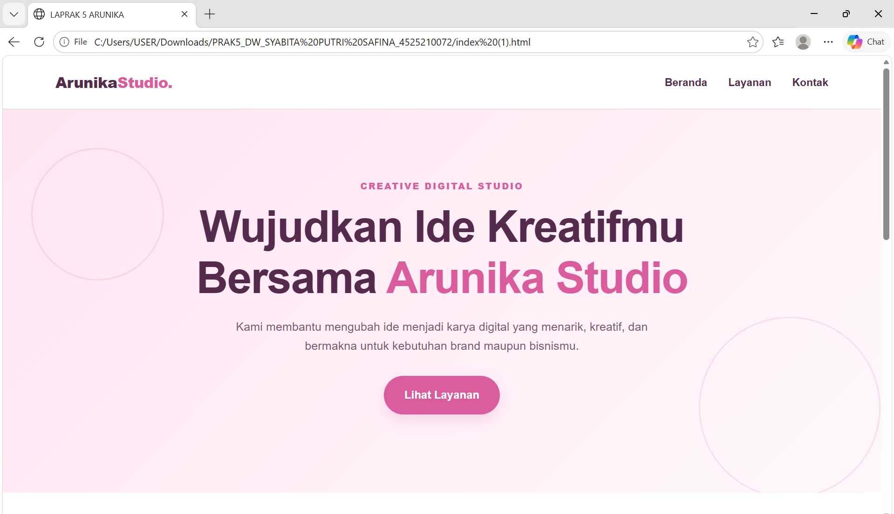
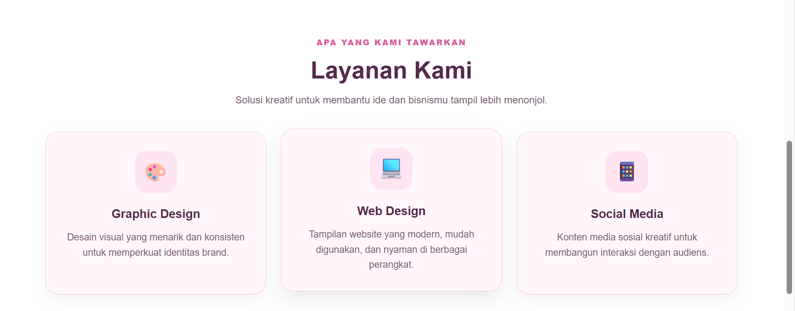
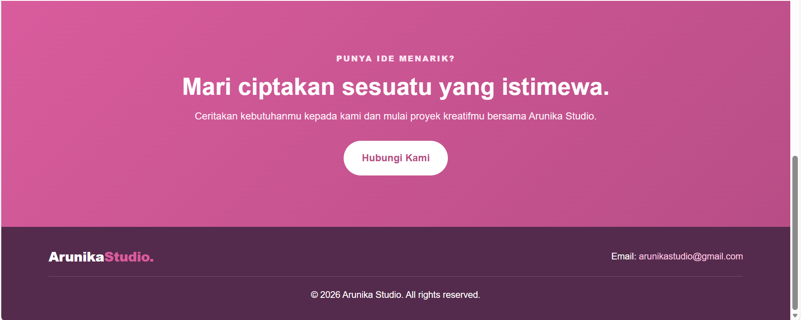
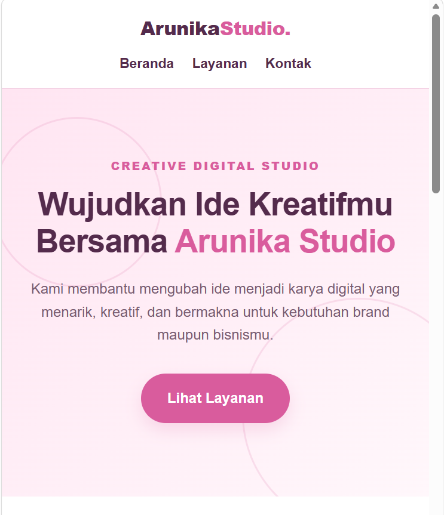
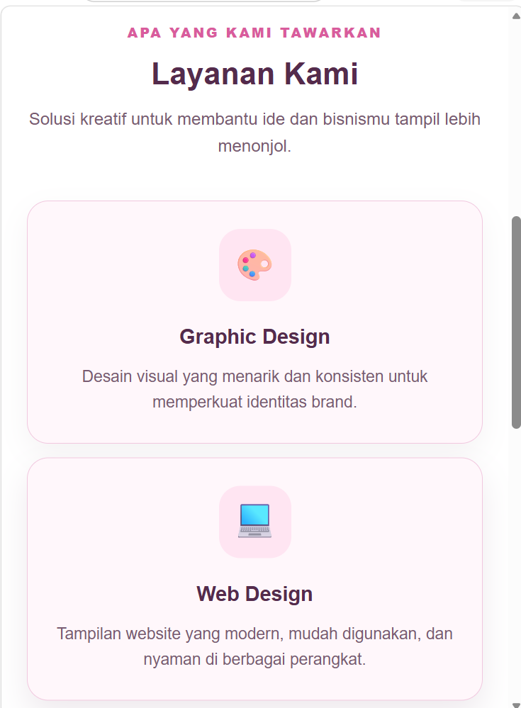
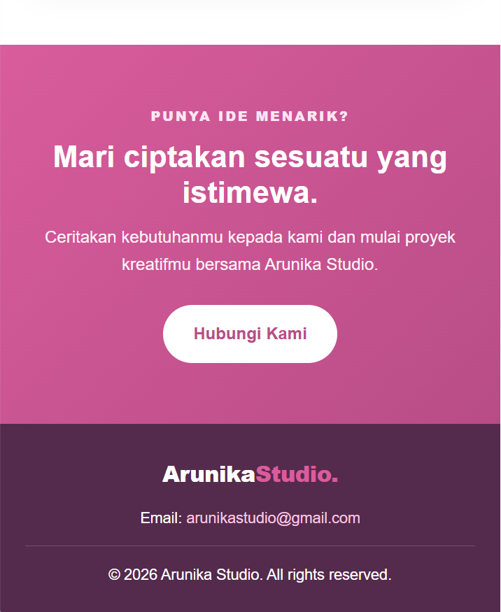

**Nama : Syabita Putri Safina** <br>
**NPM : 4525210072**

# Arunika Studio — Landing Page Responsive

## Deskripsi Proyek
Arunika Studio merupakan landing page sederhana untuk studio kreatif digital. Website ini dirancang untuk memperkenalkan studio, menampilkan layanan yang tersedia, serta menyediakan informasi kontak. Tampilan dibuat dengan tema pink agar terlihat modern, menarik, dan nyaman digunakan pada desktop maupun perangkat mobile.

## Struktur Folder
```text
arunika_studio/
├── index.html
├── style.css
└── README.md
```

## Teknologi yang Digunakan
- HTML5 untuk membuat struktur halaman website.
- CSS3 untuk mengatur desain, tata letak, warna, dan responsivitas.

## Bagian Halaman
1. **Header:** menampilkan logo Arunika Studio dan navigasi Beranda, Layanan, serta Kontak.
2. **Hero:** berisi judul utama, deskripsi singkat, dan tombol Lihat Layanan.
3. **Layanan:** menampilkan tiga layanan, yaitu Graphic Design, Web Design, dan Social Media.
4. **Kontak:** berisi ajakan untuk menghubungi Arunika Studio melalui email.
5. **Footer:** menampilkan nama studio dan informasi email.

## Palet Warna
Website menggunakan kombinasi warna pink pastel, putih, dan ungu tua untuk menciptakan tampilan yang lembut dan profesional.

| Warna | Kode HEX | Penggunaan |
|---|---|---|
| Pink pastel sangat muda | `#FFF7FB` | Latar belakang utama |
| Pink muda | `#FFE5F2` | Latar hero dan ikon layanan |
| Pink utama | `#D95C9D` | Tombol, aksen judul, dan elemen penting |
| Pink hover | `#C54889` | Warna tombol ketika kursor diarahkan |
| Ungu tua | `#542B4C` | Teks utama, logo, dan footer |
| Ungu keabu-abuan | `#795B72` | Teks deskripsi |
| Putih | `#FFFFFF` | Latar header dan bagian layanan |

## Penerapan Materi Praktikum

### 1. Box Model
Box Model diterapkan menggunakan `margin`, `padding`, `border`, dan `box-sizing: border-box` untuk mengatur ukuran elemen, jarak antarbagian, serta batas elemen.

### 2. Reusable Class
Class `.container` digunakan berulang kali untuk mengatur lebar konten. Class `.button` digunakan untuk menyamakan tampilan tombol, sedangkan `.section-space` digunakan untuk mengatur jarak vertikal antarseksi.

### 3. Pemisahan HTML dan CSS
Struktur dan konten website ditulis dalam `index.html`, sedangkan seluruh pengaturan desain ditulis dalam `style.css`. Pemisahan ini membuat kode lebih rapi dan mudah dikelola.

### 4. Media Query
Media query `@media (max-width: 767px)` digunakan untuk menyesuaikan tampilan pada layar kecil, seperti ponsel. Navigasi dapat berpindah baris, jarak konten disesuaikan, dan kartu layanan berubah dari tiga kolom menjadi satu kolom.

### 5. Responsive Design
Website dirancang agar tetap nyaman diakses pada desktop dan mobile. Penggunaan Flexbox dan CSS Grid membantu mengatur tata letak agar menyesuaikan ukuran layar.

## Cara Menjalankan
1. Buka folder proyek `arunika_studio` menggunakan Visual Studio Code.
2. Pastikan file `index.html` dan `style.css` berada dalam folder yang sama.
3. Jalankan `index.html` menggunakan browser atau ekstensi Live Server.
4. Uji tampilan desktop dan mobile dengan mengubah lebar jendela browser.

## Ringkasan Perubahan
Landing page Arunika Studio dibuat dengan memisahkan kode HTML dan CSS agar struktur proyek lebih rapi dan mudah dipelihara. Halaman terdiri dari header, hero, tiga kartu layanan, bagian kontak, dan footer. Box Model digunakan untuk mengatur ukuran serta jarak elemen, sedangkan reusable class membantu menjaga konsistensi desain. Media query ditambahkan untuk layar di bawah 768 piksel sehingga navigasi, jarak konten, dan footer dapat menyesuaikan ukuran perangkat. Kartu layanan yang tersusun dalam tiga kolom pada desktop berubah menjadi satu kolom pada layar mobile agar informasi tetap mudah dibaca. Kombinasi warna pink pastel, putih, dan ungu tua digunakan untuk membangun identitas visual Arunika Studio yang modern dan kreatif.

## Hasil Projek Tampilan Desktop




## Hasil Projek Tampilan Mobile 





## Bukti yang Dikumpulkan
- Source code atau folder proyek.
- Screenshot tampilan desktop.
- Screenshot tampilan mobile.
- README berisi deskripsi proyek dan ringkasan perubahan.


